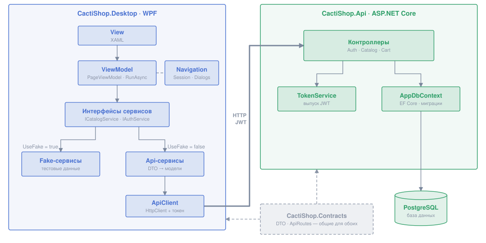

# CactiShop

Учебный интернет-магазин: десктопный клиент на WPF и серверное API на ASP.NET Core с базой PostgreSQL.

> Сначала прочитайте [CONTRIBUTING.md](CONTRIBUTING.md): как работать с ветками и PR, как настроить и запустить проект.

**Документация**

| Документ | О чём |
|---|---|
| [CONTRIBUTING.md](CONTRIBUTING.md) | Правила работы в команде, ветки, PR, первый запуск |
| [docs/new-page.md](docs/new-page.md) | Как добавить новую страницу в Desktop |

## Возможности

| Функция | API | Desktop |
|---|---|---|
| Каталог с поиском и фильтрами (категория, цена) | ✅ | ✅ |
| Карточка товара | ✅ | ✅ |
| Регистрация и вход (JWT), роли `User` / `Admin` | ✅ | ✅ |
| Список категорий | ⏳| ✅ |
| Корзина: изменить количество, удалить товар | ✅ | ⏳ |
| Добавление товара (только `Admin`) | ✅ | ⏳ |
| Избранное, заказы, отзывы, админ-панель | ⏳ | ⏳ |

## Стек

- **.NET 10**
- **API:** ASP.NET Core Web API (контроллеры), Entity Framework Core + Npgsql (PostgreSQL), JWT Bearer
- **Desktop:** WPF, CommunityToolkit.Mvvm, Microsoft.Extensions.Hosting (DI, конфигурация), HttpClientFactory
- **Общее:** проект `CactiShop.Contracts` с DTO и маршрутами API
- **Инфраструктура:** GitHub Actions (сборка, проверка формата, автоформатирование), Dependabot

## Структура решения

```
CactiShop.slnx
├── CactiShop.Api/          — сервер: контроллеры, база данных, авторизация
├── CactiShop.Contracts/    — общие для сервера и клиента DTO и маршруты API
└── CactiShop.Desktop/      — клиент на WPF
```

`Contracts` не зависит ни от ASP.NET, ни от WPF. Его подключают оба проекта, поэтому сервер и клиент гарантированно используют одни и те же типы и адреса.

## Архитектура



### Desktop

Клиент построен по шаблону **MVVM**.

| Часть | Где | Что делает |
|---|---|---|
| **View** | `Views/` | Разметка XAML. Логики нет, только привязки к ViewModel |
| **ViewModel** | `ViewModels/` | Состояние страницы и команды. Страницы наследуются от `PageViewModel` |
| **Модели** | `Models/` | Данные в том виде, в каком они нужны интерфейсу |
| **Сервисы** | `Services/` | Получение данных: интерфейсы, реализации для API и Fake-реализации |
| **Ресурсы** | `Resources/` | Стили (`Styles.xaml`) и связка ViewModel -> View (`ViewTemplates.xaml`) |

**Внедрение зависимостей.** Все сервисы и ViewModel регистрируются в `App.xaml.cs` через Generic Host. ViewModel получают зависимости через конструктор.

**Навигация.** `NavigationService` хранит текущую страницу (`CurrentPage`) и историю для кнопки «Назад». Главное окно показывает `CurrentPage` через `ContentControl`, а WPF сам подбирает нужную View по `DataTemplate` из `ViewTemplates.xaml`. После перехода вызывается `OnNavigatedToAsync(parameter)` новой страницы, и там она загружает данные.

**Загрузка и ошибки.** Все обращения к сервисам в ViewModel идут через `RunAsync` из `PageViewModel`. Он показывает индикатор загрузки (`IsBusy`), ловит ошибки сети и API и кладёт понятный текст в `ErrorMessage`.

**Сессия.** `SessionService` хранит текущего пользователя и JWT-токен. `ApiClient` сам добавляет токен в каждый запрос, а при ответе `401` выходит из сессии.

**Fake-режим.** Если в `appsettings.json` стоит `"UseFake": true`, вместо настоящих сервисов подключаются `Services/Fake/*`. Так клиент можно разрабатывать и показывать без запущенного сервера и базы.

**Модели и DTO.** Api-сервисы получают DTO из `Contracts` и переводят их в модели из `Models/`. Если изменится формат API, правится только этот перевод, а ViewModel и View не затрагиваются.

### API

| Часть | Где | Что делает |
|---|---|---|
| **Контроллеры** | `Controllers/` | Эндпоинты. Адреса берутся из `ApiRoutes` |
| **База данных** | `Data/AppDbContext.cs`, `Data/Models.cs` | EF Core: сущности и контекст |
| **Миграции** | `Migrations/` | Изменения схемы базы. Генерируются автоматически |
| **Сервисы** | `Services/` | `TokenService` (выпуск JWT), хеширование паролей, роли |

**Авторизация.** При входе сервер выдаёт JWT с id пользователя, логином и ролью. Закрытые эндпоинты помечены `[Authorize]`, админские — `[Authorize(Roles = "Admin")]`.

**Ошибки.** Сервер возвращает ошибки в формате `{ "message": "текст для пользователя" }`. Клиент показывает этот текст как есть.

**Секреты.** Ключ подписи JWT и строка подключения к базе **не хранятся в репозитории**. При разработке они задаются через `dotnet user-secrets`, на сервере — через переменные окружения. Как настроить, описано в [CONTRIBUTING.md](CONTRIBUTING.md#api-и-база).

### Эндпоинты

Все адреса объявлены в `CactiShop.Contracts/ApiRoutes.cs`.

| Метод | Адрес | Доступ | Что делает |
|---|---|---|---|
| `POST` | `api/auth/register` | все | Регистрация |
| `POST` | `api/auth/login` | все | Вход, возвращает JWT и данные пользователя |
| `GET` | `api/auth/me` | вход | Текущий пользователь |
| `GET` | `api/catalog?query=&categoryId=&minPrice=&maxPrice=` | все | Список товаров с фильтрами |
| `GET` | `api/catalog/{id}` | все | Карточка товара |
| `POST` | `api/catalog` | Admin | Добавить товар |
| `PATCH` | `api/cart` | вход | Изменить количество товара в корзине |
| `DELETE` | `api/cart/{productId}` | вход | Удалить товар из корзины |
